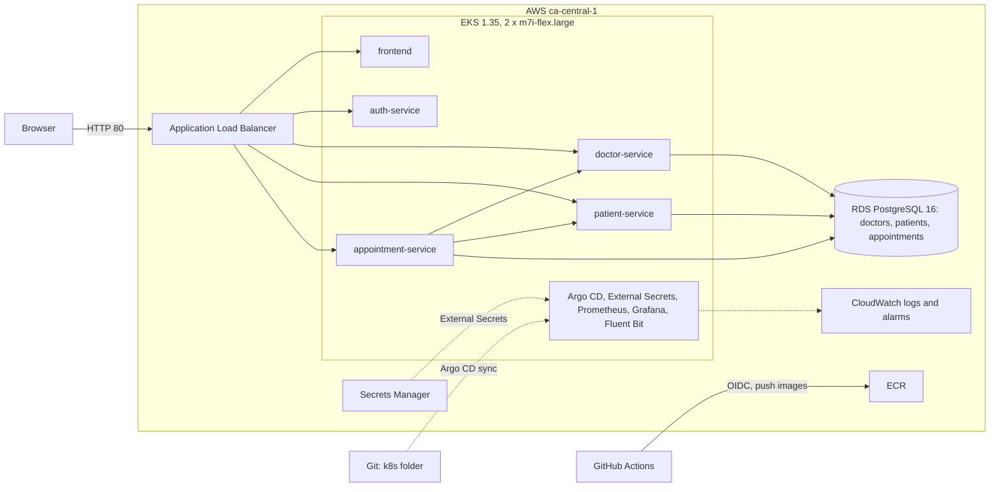
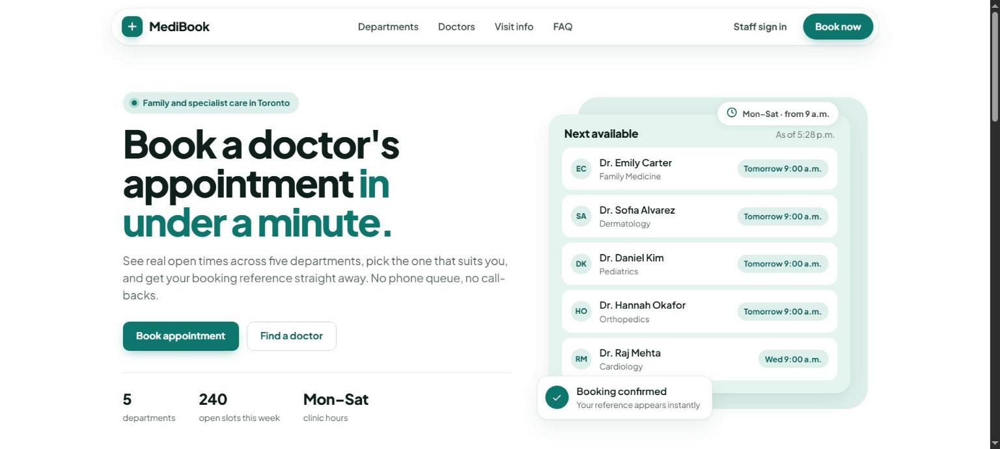
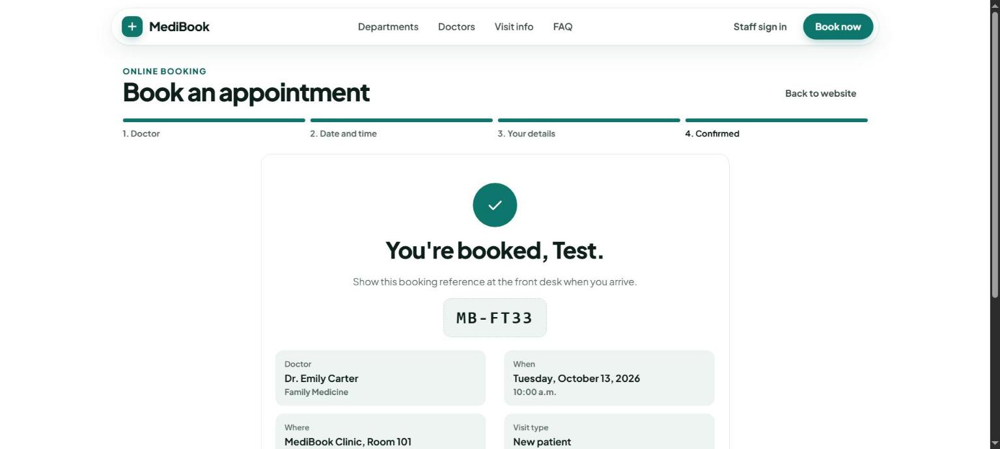
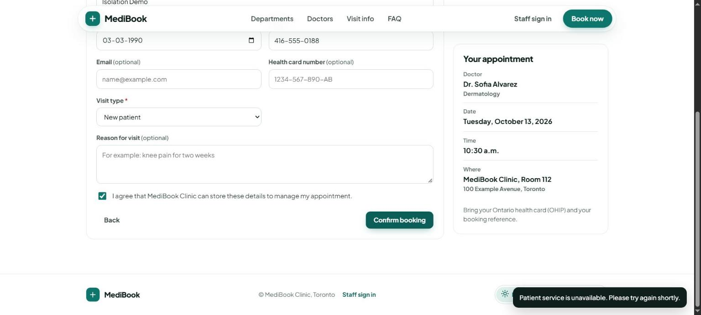

# MediBook

MediBook is a clinic appointment booking platform built as microservices and running on AWS EKS. Patients pick a doctor and a free time and get a booking reference. Front-desk staff sign in to manage patient records and the daily schedule. Four Python services and an Nginx frontend each run in their own container, and every service that stores data owns its own PostgreSQL database. Terraform builds the AWS environment, GitHub Actions tests, scans and publishes the images, and Argo CD deploys them from Git.

**What it demonstrates**

- **Microservices with clear ownership:** one database and one login per service, REST calls between services, and a clear `503` when a dependency is down.
- **Infrastructure as code:** VPC, EKS, ECR, RDS, Secrets Manager, IAM and CloudWatch alarms in Terraform, with remote state in S3.
- **CI without stored keys:** GitHub Actions signs in to AWS with OIDC, builds only the services that changed, and scans with Trivy, Checkov and TFLint.
- **GitOps:** Argo CD (app of apps) keeps the cluster equal to the `k8s/` folder and undoes manual changes.
- **Production basics:** probes, autoscaling, disruption budgets, network policies, non-root read-only containers, Prometheus metrics, central logs and alarms.

## Live environment

**URL:** <http://medibook-dev-1328580321.ca-central-1.elb.amazonaws.com>

The site is HTTP only: there is no domain, so there is no TLS certificate. Enter test data only. The address changes if the environment is rebuilt.

## Architecture on AWS



The ALB uses the same path rules as the local Nginx and never routes `/internal`. RDS is private and accepts connections only from the cluster. Details: [docs/architecture.md](docs/architecture.md).

## Components

| Component | Port | Owns data | Main endpoints |
|---|---|---|---|
| `frontend` | 8080 | none | `/`: public booking site and staff portal. Locally, Nginx also routes `/api/...` |
| `auth-service` | 8004 | none (one staff account from settings) | `POST /api/auth/login`, `GET /api/auth/me` |
| `doctor-service` | 8001 | `doctors`: departments and doctors | `GET /api/public/departments`, `/api/public/doctors`, `/api/public/slots` |
| `patient-service` | 8002 | `patients`: patient records and MRNs | `/api/staff/patients`, `POST /internal/patients/match` |
| `appointment-service` | 8003 | `appointments`: bookings and status | `GET /api/public/availability`, `POST /api/public/bookings`, `/api/staff/appointments` |

Ports are the local Docker Compose ports. Inside their containers the APIs listen on 8000. Every API also has `/health`, `/ready`, `/version` and `/metrics`. Full endpoint list: [docs/services.md](docs/services.md).

## Tech stack

| Area | Choice |
|---|---|
| Services | Python 3.12, FastAPI, psycopg 3, PyJWT, httpx |
| Frontend | HTML, CSS and JavaScript, served by unprivileged Nginx |
| Data | PostgreSQL 16: a container locally, Amazon RDS on AWS |
| Containers | Multi-stage Dockerfiles with a `test` stage, non-root users, Docker Compose |
| Infrastructure | Terraform, S3 remote state, VPC, EKS, ECR, RDS, Secrets Manager, IAM (OIDC and IRSA) |
| Kubernetes | AWS Load Balancer Controller, External Secrets Operator, HPA, PodDisruptionBudgets, NetworkPolicies |
| CI/CD | GitHub Actions, Trivy, Checkov, TFLint, Argo CD |
| Observability | Prometheus, Grafana, Fluent Bit to CloudWatch Logs, 6 CloudWatch alarms with SNS |
| Load testing | k6 |

## Quick start (local)

**Requirements:** Docker with Docker Compose v2. Run the commands from the repository root.

```bash
cp .env.example .env        # then replace every change-me value
docker compose up --build
```

To generate random values for the passwords and `JWT_SECRET`, run `python -c "import secrets; print(secrets.token_urlsafe(24))"`.

| URL | What |
|---|---|
| http://localhost:8080 | MediBook web app |
| http://localhost:8001/docs | doctor-service API (Swagger UI) |
| http://localhost:8002/docs | patient-service API |
| http://localhost:8003/docs | appointment-service API |
| http://localhost:8004/docs | auth-service API |

- **Staff sign-in:** use `STAFF_EMAIL` and `STAFF_PASSWORD` from your `.env`.
- **Demo data:** on first start, the `seed` job loads 20 demo patients and five weeks of appointments (three weeks back, two weeks ahead), then exits. On later starts it finds the data and does nothing.
- **Stop:** `docker compose down` keeps the data in the `db-data` volume. `docker compose down -v` deletes it too.
- **Database passwords** are applied only when the volume is first created. If you change them in `.env` later, run `docker compose down -v` first.

Run the tests. Each suite runs in the `test` stage of its Dockerfile, against a throwaway in-memory PostgreSQL:

```bash
docker compose run --rm auth-tests
docker compose run --rm doctor-tests
docker compose run --rm patient-tests
docker compose run --rm appointment-tests
docker compose --profile test rm -sf db-test    # remove the test database
```

More: [docs/local-dev.md](docs/local-dev.md).

## Deploy to AWS

Terraform creates the state bucket (`terraform/bootstrap`) and then the environment (`terraform/envs/dev`). Service CI tests, builds, scans and pushes the images to ECR and writes the new tags into `k8s/`. `scripts/bootstrap.sh` installs Argo CD and applies the root application; Argo CD then syncs everything in `k8s/` from Git. The full guide is in [docs/setup.md](docs/setup.md).

## Demos

All five demos passed on the live AWS environment.

| Demo | Result |
|---|---|
| Change one service | Only that service was built (1 CI job) and redeployed. The other services' pods were untouched |
| Change the cluster by hand | Argo CD restored the Git version about 2 seconds later |
| Load the availability API with k6 | The autoscaler went from 2 to 4 pods. 6,779 requests, 0 failed |
| Stop patient-service | Public pages still returned 200. Booking showed a clear error, an alarm fired, and the revert recovered in 31 seconds |
| Deploy an image that does not exist | The old pods kept serving (30 of 30 requests OK). Rollback took 10 seconds |

## Screenshots

| Home page on AWS | Booking confirmed | patient-service stopped |
|---|---|---|
|  |  |  |

## Repository layout

```
medibook/
├── services/              # auth, doctor, patient and appointment services: FastAPI app,
│                          #   tests/ and a multi-stage Dockerfile each
├── frontend/              # Static web app, nginx.conf, Dockerfile
├── db/                    # Init scripts: per-service logins and databases, test databases
├── tools/                 # seed/ (demo data job), load-test/ (k6 script)
├── terraform/             # bootstrap/ (state bucket), modules/, envs/dev/
├── k8s/                   # Manifests per service, platform, ingress, network policies,
│                          #   monitoring, logging, and argocd/ (app of apps)
├── scripts/bootstrap.sh   # Installs Argo CD and applies the root application
├── .github/workflows/     # service-ci, terraform-ci, terraform-apply
├── docs/                  # Documentation and screenshots
├── docker-compose.yml     # Local stack, plus the "test" profile
└── .env.example           # Copy to .env (git-ignored)
```

## Documentation

| Document | What it covers |
|---|---|
| [docs/architecture.md](docs/architecture.md) | AWS design, request routing, service boundaries and their trade-offs |
| [docs/services.md](docs/services.md) | Every endpoint, the booking flow, and the environment variables of each service |
| [docs/local-dev.md](docs/local-dev.md) | Running, testing and checking the stack with Docker Compose |
| [docs/setup.md](docs/setup.md) | Building the AWS environment step by step |
| [docs/terraform.md](docs/terraform.md) | Terraform layout, modules and remote state |
| [docs/cicd-gitops.md](docs/cicd-gitops.md) | GitHub Actions pipelines and Argo CD deployment |
| [docs/operations.md](docs/operations.md) | Day-to-day operation: deploys, monitoring, logs and alarms |
| [docs/security.md](docs/security.md) | Security controls and known limits |
| [docs/costs.md](docs/costs.md) | What the AWS environment costs to run |
| [docs/cleanup.md](docs/cleanup.md) | Tearing the environment down in the right order |
| [docs/troubleshooting.md](docs/troubleshooting.md) | Common problems and their fixes |
