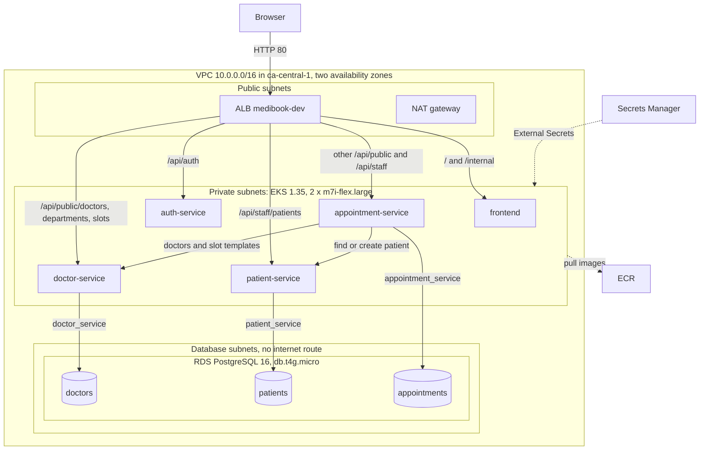

# Architecture

This page explains how MediBook is split into services, how a request reaches them on AWS, and why it is built this way. For the endpoints of each service, see [services.md](services.md).

## AWS overview

| Layer | What runs there |
|---|---|
| Public subnets | The ALB `medibook-dev`, created by the AWS Load Balancer Controller from `k8s/ingress/ingress.yaml`, and one NAT gateway |
| Private subnets | The EKS managed node group: 2 x m7i-flex.large (Amazon Linux 2023). Each Deployment runs 2 to 4 pods (HPA at 70% CPU), spread across the nodes |
| Database subnets | RDS PostgreSQL 16, `db.t4g.micro`, single AZ, encrypted storage, not publicly accessible. Port 5432 is open only to the EKS cluster security group |
| Regional services | ECR (one repository per image), Secrets Manager, CloudWatch Logs and alarms, and the S3 bucket for Terraform state |

Cluster add-ons, all deployed by Argo CD from `k8s/argocd/apps/`:

| Add-on | Job |
|---|---|
| AWS Load Balancer Controller | Builds the ALB from the Ingress. Targets are pod IPs (target type `ip`) |
| External Secrets Operator | Copies values from Secrets Manager into one Kubernetes Secret per service, refreshed every hour |
| kube-prometheus-stack | Prometheus and Grafana. Scrapes each API's `/metrics` every 30 seconds |
| Fluent Bit | Ships the MediBook container logs to the CloudWatch log group `/medibook/dev/services` |
| NetworkPolicies | Deny all ingress in the `medibook` namespace, then allow only the expected callers |

Six CloudWatch alarms (three on RDS, three on the ALB) watch the platform from outside the cluster and notify an SNS topic.

## Request routing

The browser only calls relative paths. Locally, Nginx in the frontend container routes them. On AWS, the ALB applies the same rules.

| Path | Goes to | Access |
|---|---|---|
| `/api/auth/...` | auth-service | `login` is public, `me` needs a staff token |
| `/api/public/departments`, `/api/public/doctors`, `/api/public/slots` | doctor-service | Public |
| Other `/api/public/...` (`availability`, `next-available`, `summary`, `bookings`) | appointment-service | Public |
| `/api/staff/patients...` | patient-service | Staff token |
| Other `/api/staff/...` (`appointments`) | appointment-service | Staff token |
| `/internal/...` | Not routed to any service. It reaches the frontend, and Nginx returns 404 | Blocked |
| Everything else | frontend | Public |

- **The most specific path wins.** Nginx picks the longest matching prefix. The load balancer controller orders the `Prefix` paths longest first, so `/api/public/doctors` stays ahead of `/api/public`.
- **`/metrics` is never routed to a service.** Through the ALB or Nginx it reaches the frontend. Prometheus scrapes it inside the cluster.
- **Health checks.** The ALB checks `/ready` on the APIs and `/` on the frontend. The namespace turns on pod readiness gates, so a new pod counts as ready only after the ALB sees it as healthy.
- **Traffic inside the cluster** is limited by NetworkPolicies: ALB subnets to the frontend and the APIs, frontend to the APIs, appointment-service to doctor-service and patient-service, and the `monitoring` namespace to the APIs on port 8000.

## Why microservices

| Reason | What it means here | Shown by |
|---|---|---|
| Independent deployments | A change to one service builds, scans and ships only that service | Demo 1: one CI job, two new pods, the rest untouched |
| Clear ownership | Patient data lives only in patient-service. Other services ask it through an API | Database logins cannot open another service's database |
| Failure isolation | If patient-service stops, the site still shows doctors and free times. Only booking fails, with a clear message | Demo 4: public pages 200, booking 503 |
| Separate scaling | Each service has its own autoscaler | Demo 3: appointment-service scaled from 2 to 4 pods under load |

### Why only four services

The services follow the clinic's data: doctors and their schedules, patients, appointments, and staff sign-in. Four is a deliberate size. It covers every idea the project needs to show:

- a service that calls others (appointment-service),
- services that own data and only answer calls (doctor-service and patient-service),
- a stateless service with no database (auth-service),
- one database per service and one pipeline per service.

More services would add pipelines, manifests and network calls without showing anything new. Fewer would merge data that has different owners. auth-service is a small stand-in identity provider; Amazon Cognito could replace it.

## Database per service

There is one PostgreSQL server with three databases: `doctors`, `patients` and `appointments`. Each database has its own login (`doctor_service`, `patient_service`, `appointment_service`), owned by that login, with `CONNECT` revoked from everyone else. auth-service has no database.

- **Locally** the server is a `postgres:16-alpine` container, and `db/init/01-create-databases.sh` creates the logins and databases on the first start.
- **On AWS** the server is one RDS instance. The `db-init` Job (an Argo CD sync hook running `k8s/platform/db-init.sql`) creates the same logins and databases. Its SQL is safe to run again.
- **Each service receives only its own database secret.** It knows nothing but its own `DB_HOST`, `DB_NAME` and login.
- **Each service creates its own tables** at start with `CREATE TABLE IF NOT EXISTS`. There is no migration tool yet.
- **No foreign keys cross services.** An appointment stores `patient_id` and `doctor_id`, plus a copy of the patient's name and MRN taken at booking time.

The isolation is logical, not physical:

| Benefit | Cost |
|---|---|
| One instance to run and pay for | The three databases share CPU, memory and the connection limit. A heavy query in one can slow the others |
| Real separation of data and logins, enforced by PostgreSQL | If the instance is down, all three services lose their data at once. The instance is single-AZ |
| A service can move to its own instance by changing `DB_HOST` only | No joins across services. Some data is copied, such as the patient's name on an appointment |

## Calls between services

All calls are synchronous REST over HTTP with JSON. There is no message queue.

- **Only appointment-service calls other services.** It reads doctors and slot templates from doctor-service, and finds, creates and reads patients through patient-service. doctor-service and patient-service never call anyone.
- **No service calls auth-service to check a token.** patient-service and appointment-service verify the staff JWT themselves with the shared `JWT_SECRET`. If auth-service is down, only new sign-ins fail.
- **Services find each other by name** (`http://doctor-service:8000`). The name is the same in Docker Compose and in Kubernetes, so the code does not change.

| Where | Timeout |
|---|---|
| appointment-service to doctor-service or patient-service (`httpx`) | 3 seconds |
| Any service to its own database (connect) | 3 seconds |
| Nginx to a service (connect), locally | 5 seconds |

When a call fails, the caller answers with a clear `503` instead of crashing:

| Failure | Response |
|---|---|
| doctor-service unreachable, slow, or returns 5xx or bad JSON | `503` "Doctor service is unavailable. Please try again shortly." |
| patient-service unreachable, slow, or returns 5xx or bad JSON | `503` "Patient service is unavailable. Please try again shortly." |
| The service's own database is unreachable | `503` "Database unavailable" |

The doctor list is cached in appointment-service for 60 seconds, because the roster rarely changes. There are **no retries and no circuit breaker**. That keeps the code small, but while a dependency hangs, every request that needs it waits for the timeout before it fails. It is a known limitation.

Synchronous calls fit this flow: a booking needs an immediate answer (a reference or a `409`), and the patient record must exist before the appointment is saved.

*Demo 4: with patient-service scaled to zero, booking shows a clear error and the rest of the site keeps working.*

## Local and AWS side by side

The same images run in both places. Only the settings change.

| Concern | Local (Docker Compose) | AWS |
|---|---|---|
| Entry point | Nginx in the frontend container, port 8080 | ALB with the same path rules (Ingress) |
| Service discovery | Compose service names | Kubernetes Service names, same names and port |
| Database server | One `postgres:16-alpine` container | One RDS PostgreSQL 16 instance |
| Logins and databases | `db/init/01-create-databases.sh` on the first start | `db-init` Job, same result |
| Secrets | `.env` (git-ignored) | Secrets Manager, synced by External Secrets |
| Database TLS | `DB_SSLMODE=prefer` (default) | `DB_SSLMODE=require` |
| Demo data | `seed` job, `SEED_ENABLED=true` | No seeding, `SEED_ENABLED=false` |
| Health | Compose health checks on `/health` | Startup and liveness probes on `/health`, readiness on `/ready`, ALB health checks |
| Images | Built locally | Built, tested and scanned by GitHub Actions, stored in ECR |
| Deploy | `docker compose up` | Argo CD syncs `k8s/` from Git |
| Scaling | One container per service | 2 to 4 pods per Deployment |
| Logs and metrics | `docker compose logs`, `/metrics` on each service port | Fluent Bit to CloudWatch Logs, Prometheus and Grafana, CloudWatch alarms |

## Possible extensions (not built)

- **Asynchronous notifications with SQS and SES.** appointment-service could publish a "booking created" message to an SQS queue, and a small worker could send the confirmation email with SES. Email would then never slow down or fail a booking. Nothing in the current code uses SQS or SES.
- **Retries and a circuit breaker** for the calls from appointment-service.
- **HTTPS** with a domain and an ACM certificate on the ALB.
- **Amazon Cognito** in place of auth-service.
