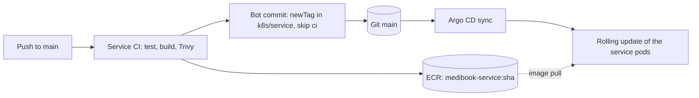
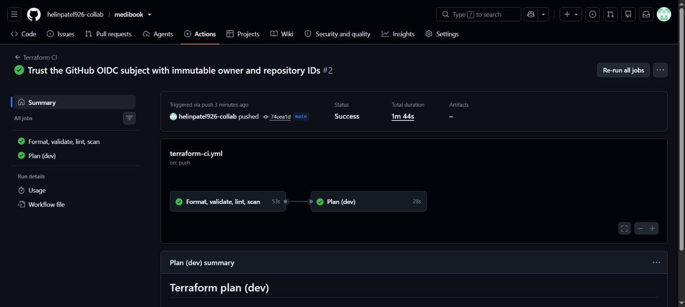
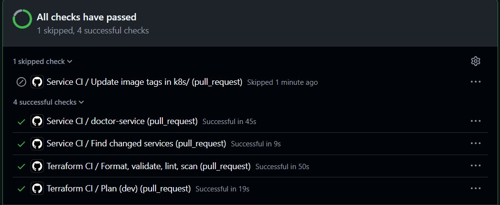
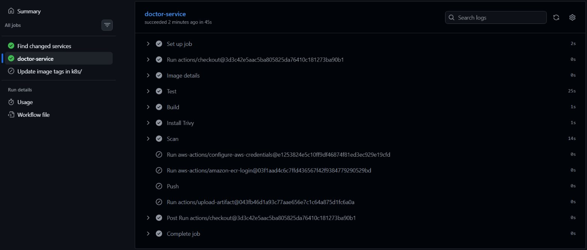

# CI/CD and GitOps

GitHub Actions tests, scans and builds every change. Argo CD deploys whatever is committed under `k8s/`. GitHub stores no AWS keys, and nobody runs `kubectl apply` to deploy the app.



## Workflows

| Workflow | Triggers | Jobs |
|---|---|---|
| `terraform-ci.yml` (Terraform CI) | Pull requests and pushes to `main` that touch `terraform/**` or the workflow file; manual | `checks`, then `plan` |
| `terraform-apply.yml` (Terraform apply) | Manual only, on `main` | `apply`, after approval in the `dev` environment |
| `service-ci.yml` (Service CI) | Pull requests and pushes to `main` that touch `services/**`, `frontend/**`, `db/init-test/**`, `docker-compose.yml`, `.env.example` or the workflow file; manual | `changes`, `build` (one job per service), `update-manifests` |

All jobs run on GitHub-hosted `ubuntu-24.04`. The default token permission is `contents: read`, and jobs ask for more only where needed.

### Terraform CI

| Job | Steps |
|---|---|
| Format, validate, lint, scan | `terraform fmt -check -recursive -diff`; `terraform init -backend=false` and `terraform validate` in `bootstrap` and `envs/dev`; TFLint; Checkov (see [terraform.md](terraform.md#lint-and-scan)) |
| Plan (dev) | Skipped for pull requests from forks. Assumes the `tf-plan` role through OIDC, then runs `terraform init` and `terraform plan -lock-timeout=5m -detailed-exitcode -out=dev.tfplan`. Writes the plan (last 200 lines) or "No changes" to the run summary. Fails only when the plan itself fails, not when it finds changes |



### Terraform apply

1. Read the plan of the same commit in Terraform CI.
2. **Actions → Terraform apply → Run workflow** on `main`. The job runs only on `refs/heads/main`.
3. The job waits in the GitHub environment `dev` until a required reviewer approves it.
4. It assumes the `tf-apply` role, runs `terraform init` and `terraform plan`, then counts the resources the plan would delete or replace.
5. If that count is above 0 and the run was not started with `allow_destroy`, the job stops. Otherwise it applies the saved plan.

Plan and apply share the concurrency group `terraform-dev` and never cancel each other. The S3 lock file protects the state as well.

The `dev` environment has one required reviewer, allows only `main`, and administrators cannot bypass it. The first run (2026-10-12) waited for approval, then signed in with `tf-apply`, found 0 resources to destroy and finished with `Apply complete! Resources: 0 added, 0 changed, 0 destroyed.`

### Service CI

| Job | Steps |
|---|---|
| Find changed services | `dorny/paths-filter` outputs the services whose files changed. A manual run selects all five |
| Build (matrix, `fail-fast: false`) | **Test:** `docker compose --profile test run --rm --build <name>-tests` (for example `auth-tests`), with a throwaway test database; the frontend has no test step. **Build:** the `runtime` stage of each API's Dockerfile; the frontend Dockerfile has a single stage. **Scan:** Trivy. On `main` only: **Push** the image to ECR as `medibook-<service>:<first 7 characters of the commit SHA>` with the `ecr-push` role, and upload the tag as an artifact |
| Update image tags in k8s/ | On `main` only. Runs even if one service failed, so the others still deploy. Writes each new tag into `k8s/<service>/kustomization.yaml` with `yq`, commits as `github-actions[bot]`, and pushes. Retries up to 3 times with `git pull --rebase` |

Pull requests run test, build and scan, but never push or commit. Runs are grouped per Git ref. A newer push to a pull request cancels its older run; runs on `main` are never cancelled.

This was checked with a test pull request (2026-10-12, closed without merging) that changed one line in doctor-service and one Terraform variable description:

| Workflow | Result |
|---|---|
| Service CI | Only `doctor-service` ran: 7 tests passed, the image was built, and Trivy found no fixable HIGH or CRITICAL issue. The AWS sign-in, ECR login, push and artifact steps and the tag update job were skipped, and the image tag does not exist in ECR |
| Terraform CI | Format, validate, TFLint and Checkov (259 passed, 0 failed, 28 skipped) passed. The plan signed in with `tf-plan` through the `pull_request` subject and reported no changes |





## Change detection

Only the services whose files changed are built:

| Service | Rebuilt when these change |
|---|---|
| auth-service | `services/auth-service/**` |
| doctor-service, patient-service, appointment-service | Their own `services/<name>/**`, and `db/init-test/**` |
| frontend | `frontend/**` |
| The four APIs | `docker-compose.yml`, `.env.example` (the tests run through Docker Compose) |
| All five | `.github/workflows/service-ci.yml`, or a manual run |

A change to one service builds and deploys only that service. In this run, only appointment-service changed: one matrix job ran, and the tag job took 7 seconds.


## Trivy gate

Trivy v0.74.0 is downloaded from its GitHub release and checked against a pinned SHA-256 before it runs:

```bash
trivy image --severity HIGH,CRITICAL --ignore-unfixed --exit-code 1 --no-progress medibook-<service>:<tag>
```

The job fails on any HIGH or CRITICAL vulnerability that has a fix, so an image with such a finding is never pushed. Vulnerabilities without a published fix are reported by ECR's own scan on push and do not block the build.

## ECR immutable tags

The repositories use `image_tag_mutability = IMMUTABLE`, so a tag always means the same image. A re-run for the same commit first checks `aws ecr describe-images`. If the tag already exists, it keeps that image and skips the push. The lifecycle policy keeps the last 10 images per repository.

## Bot commit of the tags

The `update-manifests` job changes only the `newTag` lines, for example:

```yaml
images:
  - name: medibook-appointment-service
    newName: <account-id>.dkr.ecr.ca-central-1.amazonaws.com/medibook-appointment-service
    newTag: "d44e718"
```

The commit message is `Deploy <services> at <sha> [skip ci]`. `[skip ci]` stops the commit from starting another workflow run. This job is the only one with `contents: write`.

## AWS access with OIDC

The workflows request a GitHub OIDC token (`id-token: write`) and exchange it for one-hour credentials with `aws-actions/configure-aws-credentials`. GitHub stores no AWS keys or secrets.

| Role | Trusted subject (`sub`) | Permissions |
|---|---|---|
| `medibook-dev-github-tf-plan` | `repo:<repo>:pull_request`, `repo:<repo>:ref:refs/heads/main` | `ReadOnlyAccess`, write and delete on the state lock file only, and `GetSecretValue` on the 5 app secrets (the plan refreshes their versions) |
| `medibook-dev-github-tf-apply` | `repo:<repo>:environment:dev` | `AdministratorAccess`. Terraform creates IAM roles, so apply needs admin rights. The trust policy and the environment's required reviewer guard this role |
| `medibook-dev-github-ecr-push` | `repo:<repo>:ref:refs/heads/main` | `ecr:GetAuthorizationToken`, plus push and pull on the 5 MediBook repositories only |

Every trust policy also requires `aud = sts.amazonaws.com`. `<repo>` is GitHub's subject form with the immutable IDs, `<owner>@<owner-id>/<name>@<repo-id>`, taken from the `github_repository` variable. A repository that is deleted and created again under the same name gets a new ID, so it cannot assume these roles. Pull requests from forks never reach the plan job. The wider security model is in [security.md](security.md).

## Pinned actions and tools

Each action is pinned to a full commit SHA, each tool container to an image digest, and the Trivy binary to its checksum.

| Item | Version | Pinned by |
|---|---|---|
| `actions/checkout` | v7.0.1 | Commit SHA |
| `hashicorp/setup-terraform` | v4.0.1 (Terraform 1.16.5) | Commit SHA |
| `aws-actions/configure-aws-credentials` | v6.3.0 | Commit SHA |
| `aws-actions/amazon-ecr-login` | v2.1.7 | Commit SHA |
| `dorny/paths-filter` | v4.0.3 | Commit SHA |
| `actions/upload-artifact`, `actions/download-artifact` | v7.0.1, v8.0.1 | Commit SHA |
| TFLint | v0.64.0 | Image digest `sha256:1c595f42...` |
| Checkov | 3.3.19 | Image digest `sha256:d3e96ada...` |
| Trivy | 0.74.0 | SHA-256 `2ae6fe3e...` of the release archive |

## Argo CD

`scripts/bootstrap.sh` installs Argo CD (chart `argo-cd` 10.9.2, Argo CD v3.5.3) and applies one Application, `root` (`k8s/argocd/root.yaml`). This is the app-of-apps pattern: `root` watches `k8s/argocd/apps/` on `main`, so adding an Application file there and pushing it deploys something new. A custom health check for `Application` resources (in `k8s/argocd/values.yaml`) makes `root` wait for each wave to be healthy before it starts the next one.

### Sync waves

| Wave | Application | Deploys |
|---|---|---|
| 0 | `aws-load-balancer-controller`, `external-secrets` | Helm charts 3.5.0 and 2.11.0, each with its IRSA role |
| 1 | `platform` | Namespace `medibook`, default `gp3` StorageClass, ClusterSecretStore `aws-secrets-manager`, the `db-init` job |
| 2 | `auth-service`, `doctor-service`, `patient-service`, `appointment-service` | One Application per API, from `k8s/<service>/` |
| 3 | `frontend` | After the APIs, because Nginx resolves their Service names at start |
| 4 | `ingress` | The Ingress; the controller creates the ALB |
| 5 | `network-policies` | Default deny, then the allowed paths |
| 6 | `monitoring`, `logging` | kube-prometheus-stack 91.8.1 and Fluent Bit 0.58.2 |
| 7 | `monitoring-config` | ServiceMonitors and the MediBook dashboard |

### Sync policy

- Every Application has `automated` sync with `prune: true` (anything deleted from Git is removed) and `selfHeal: true` (manual changes in the cluster are undone). Failed syncs retry with backoff.
- Child Applications carry the `resources-finalizer.argocd.argoproj.io` finalizer, so deleting one also deletes its resources. `root` has no finalizer, so deleting it alone leaves the child apps running (see [cleanup.md](cleanup.md)).
- Deployments set no replica count. The HPA owns it, so self-heal does not fight the autoscaler.
- To change anything, edit the manifest and push. A `kubectl edit` is undone within seconds.

### From commit to pods

1. A change under `services/appointment-service/` is merged to `main`.
2. Service CI builds only appointment-service: tests, image, Trivy scan, push of `medibook-appointment-service:<sha>` to ECR.
3. The bot commits the new `newTag` to `k8s/appointment-service/kustomization.yaml`.
4. Argo CD polls Git and finds the change within about three minutes. A refresh makes it look at once: `kubectl annotate application appointment-service -n argocd argocd.argoproj.io/refresh=normal --overwrite`.
5. Argo CD syncs the `appointment-service` app, and Kubernetes starts a rolling update of that Deployment only.
6. A new pod counts as ready only when its ALB target is healthy (pod readiness gate). Old pods pause 10 seconds in `preStop` so the ALB can drain them.

When this was tested, the bot commit changed one file, Argo CD applied it 7 seconds after a refresh, and the rollout took 19 seconds. Only the two appointment-service pods were replaced; the other eight kept running.

A bad tag fails safely: the new pod cannot pull its image, and the old pods keep serving. `git revert` of the tag commit restores the previous state. See [operations.md](operations.md) for day-to-day tasks and [troubleshooting.md](troubleshooting.md) for failures.
