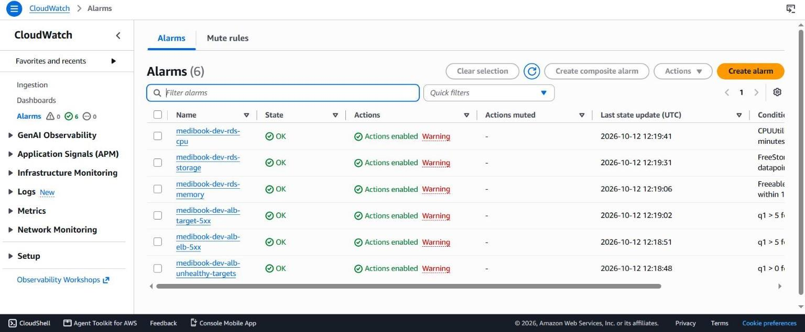
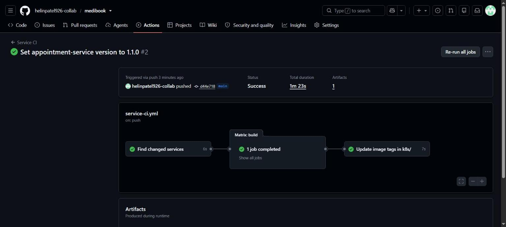

# Operations

How to run MediBook on EKS day to day: deploying, rolling back, scaling, opening the admin UIs, reading logs and alarms, and repeating the demos.

One rule sits behind all of it: **Git is the source of truth.** Argo CD keeps the cluster equal to the `k8s/` folder on `main`, so every change is a commit. The pipeline is described in [CI/CD and GitOps](cicd-gitops.md). For failures, see [Troubleshooting](troubleshooting.md).

## Before you start

```bash
aws login                                                   # short-lived session, no access keys
aws eks update-kubeconfig --region ca-central-1 --name medibook-dev
kubectl get applications -n argocd                          # all 14 should be Synced / Healthy
kubectl get pods,hpa,pdb -n medibook                        # at least 2 pods per service
```

The public address (HTTP only):

```bash
kubectl get ingress medibook -n medibook -o jsonpath='{.status.loadBalancer.ingress[0].hostname}'
```

## Deploy a new version

```text
commit -> Service CI -> image in ECR -> bot commits the new tag -> Argo CD rolls it out
```

| Step | What happens |
|---|---|
| 1. Pull request | Service CI tests, builds and scans (Trivy) **only the services whose files changed**. Nothing is pushed |
| 2. Merge to `main` | The same jobs run again. Each image is pushed to ECR as `medibook-<service>:<short SHA>` with the `ecr-push` role (GitHub OIDC) |
| 3. Tag commit | The `update-manifests` job writes the new `newTag` into `k8s/<service>/kustomization.yaml` and commits it as `github-actions[bot]` with `[skip ci]` |
| 4. Argo CD | Picks up the commit (it polls Git about every 3 minutes) and syncs only that service's Application. The rolling update keeps the old pods serving until the new ones are healthy in the ALB |

To deploy now instead of waiting for the poll, and to watch the rollout:

```bash
kubectl annotate application appointment-service -n argocd argocd.argoproj.io/refresh=normal --overwrite
kubectl rollout status deployment/appointment-service -n medibook
kubectl get deployment appointment-service -n medibook -o jsonpath='{.spec.template.spec.containers[0].image}'
```

To rebuild all five images, open Actions → Service CI → **Run workflow** on `main`.

## Change configuration only in Git

| What | Where |
|---|---|
| Environment variables, probes, resources | `k8s/<service>/deployment.yaml` |
| Autoscaling range | `k8s/<service>/hpa.yaml` |
| ALB routes | `k8s/ingress/ingress.yaml`, kept the same as `frontend/nginx.conf` |
| Allowed pod traffic | `k8s/network-policies/` |
| Monitoring and logging | `k8s/monitoring/`, `k8s/logging/` |
| New Argo CD application | A new file in `k8s/argocd/apps/` (app of apps) |
| Secret values | Secrets Manager: created by Terraform (`terraform/modules/secrets/`), or by RDS for the admin login. Never in Git |
| AWS infrastructure | `terraform/`. Terraform CI plans every change |

Every Application has automated sync with `prune` and `selfHeal`. A `kubectl edit`, `patch` or `delete` on a managed object is undone within seconds (demo 2 measured about 2 s). There are two deliberate exceptions. The HPA owns the replica count, so the Deployments have no `replicas` field. And `kubectl rollout restart` is used to make pods read a changed Secret.

## Roll back

To roll back, revert the commit and push. Argo CD does the rest.

| Situation | Command |
|---|---|
| The new image is broken | `git revert <tag commit>`: the bot's "Deploy ... [skip ci]" commit, or a manual `newTag` change. Only `k8s/` changes, so Service CI does not run, and Argo CD deploys the previous image as it is |
| The code change is wrong | `git revert <code commit>`. Service CI builds a new image with a new tag, so this is a roll forward |
| A manifest change is wrong | `git revert <commit>` |

- Demo 5 rolled back in **10 seconds**.
- ECR keeps the **last 10 images** per repository, so you can only roll back to one of those. Tags are immutable, so a tag always means the same image.
- Do not use `kubectl rollout undo`. The result no longer matches Git, so Argo CD puts the Git version straight back.

## Scaling

| Level | Setting | Notes |
|---|---|---|
| Pods | One HPA per service: **2 to 4 replicas at 70% CPU** | CPU is measured against the requests: 50m for the APIs, 20m for the frontend. Scale-down waits for the default 5-minute window |
| Stopping a service on purpose | `replicas: 0` in its Deployment, committed to Git | The HPA does not scale a Deployment that is at zero. Revert the commit to bring the service back (demo 4) |
| Nodes | Node group of 2 to 3 × m7i-flex.large, 50 pods per node | There is no Cluster Autoscaler. Terraform ignores `desired_size` after the node group is created, so add a third node with the CLI (below). Change the limits in `terraform/envs/dev/main.tf` |

```bash
aws eks update-nodegroup-config --cluster-name medibook-dev --nodegroup-name medibook-dev-default \
  --scaling-config minSize=2,maxSize=3,desiredSize=3
```

The HPA overrules `kubectl scale`. To change the range, edit `hpa.yaml`.

## Disruptions and clean rollouts

| Setting | Effect |
|---|---|
| PodDisruptionBudget, `minAvailable: 1` per service | A node drain or upgrade never removes the last pod of a service. `unhealthyPodEvictionPolicy: AlwaysAllow` lets broken pods be evicted, so they don't block drains |
| Node group `max_unavailable = 1` | Nodes are replaced one at a time. Both nodes were replaced this way for the IMDS hop-limit change (8m25s, before the apps were deployed) |
| Topology spread | The two pods of a service run on different nodes when possible |
| Readiness gates | The `medibook` namespace has the label `elbv2.k8s.aws/pod-readiness-gate-inject: enabled`. A new pod counts as ready only after the ALB reports it healthy, so a rollout never removes old pods before the new ones take traffic |
| `preStop` sleep of 10 s, deregistration delay of 30 s | A stopping pod keeps serving while the ALB drains it |
| Probes | Startup and liveness use `/health`, which never touches the database, so a database outage doesn't restart pods. Readiness uses `/ready`, which checks the service's own database. The ALB health checks use the same paths (`/` for the frontend) |
| Rolling update | Default strategy. With 2 replicas, one extra pod is started, and no old pod is removed until the new one is ready |

## Admin UIs (port-forward only)

None of these UIs has a public address.

| UI | Command | URL | Sign-in |
|---|---|---|---|
| Argo CD | `kubectl port-forward service/argocd-server -n argocd 8080:80` | http://localhost:8080 | `admin`. The initial password is in the `argocd-initial-admin-secret` Secret |
| Grafana | `kubectl port-forward service/kube-prometheus-stack-grafana -n monitoring 3000:80` | http://localhost:3000 | `admin`. The password is in the `grafana-admin` Secret |
| Prometheus | `kubectl port-forward service/kube-prometheus-stack-prometheus -n monitoring 9090:9090` | http://localhost:9090 | none |

```bash
kubectl get secret argocd-initial-admin-secret -n argocd -o jsonpath='{.data.password}' | base64 --decode; echo
kubectl get secret grafana-admin -n monitoring -o jsonpath='{.data.admin-password}' | base64 --decode; echo
```

The local Docker Compose frontend also uses port 8080. If both are running, forward Argo CD to another local port, such as `8081:80`.

Grafana loads the **MediBook overview** dashboard from `k8s/monitoring/config/dashboards/`. It shows request rate, 5xx error rate and p95 latency per service, container restarts, CPU and memory per pod, and scrape targets up.

## Logs

Fluent Bit runs on every node and sends the container logs of the `medibook` namespace to CloudWatch Logs. It uses its own IRSA role, which can only write to one log group.

| Log group | Content | Kept |
|---|---|---|
| `/medibook/dev/services` | One log stream per pod, named after the pod. Fields `log`, `stream`, `time` and `kubernetes.*` | 3 days |
| `/aws/eks/medibook-dev/cluster` | EKS control plane logs: `api`, `audit`, `authenticator` | 3 days |

```bash
# Follow one service (stream names start with the pod name)
aws logs tail /medibook/dev/services --follow --log-stream-name-prefix appointment-service
# The last hour, errors only
aws logs tail /medibook/dev/services --since 1h --filter-pattern ERROR
```

A CloudWatch Logs Insights query on `/medibook/dev/services`:

```text
fields @timestamp, kubernetes.pod_name, log
| filter kubernetes.container_name = "appointment-service" and log like /503/
| sort @timestamp desc
| limit 50
```

`kubectl logs` shows the logs of running pods. CloudWatch also keeps them after a pod is gone. Logs from other namespaces, such as Argo CD and the add-ons, are not shipped, so read them with `kubectl logs`.

## Alarms and notifications

Six CloudWatch alarms, defined in `terraform/envs/dev/alarms.tf`, watch the database and the load balancer from outside the cluster. They keep working even if the cluster itself is in trouble. Alertmanager is turned off on purpose.

| Alarm | Fires when |
|---|---|
| `medibook-dev-rds-cpu` | Database CPU is above 80% for 15 minutes |
| `medibook-dev-rds-storage` | Less than 2 GiB of database storage is left |
| `medibook-dev-rds-memory` | Less than 100 MiB of database memory is free for 15 minutes |
| `medibook-dev-alb-elb-5xx` | The ALB itself returns more than 5 errors in 5 minutes, for example when no target is healthy |
| `medibook-dev-alb-target-5xx` | The services return more than 5 errors in 5 minutes |
| `medibook-dev-alb-unhealthy-targets` | Any ALB target stays unhealthy for 3 minutes |

The ALB belongs to the load balancer controller, not to Terraform. So the three ALB alarms use CloudWatch Metrics Insights queries over all load balancers in the region instead of a fixed ARN. This works because the account has only one ALB in `ca-central-1`.



**Email notifications.** Alarm and recovery notifications go to the SNS topic `medibook-dev-alarms`. Nobody receives them until `alarm_email` is set:

```bash
cd terraform/envs/dev
terraform plan -var="alarm_email=ops@example.com" -out=dev.tfplan   # in PowerShell, quote each -name=value argument
terraform apply dev.tfplan
```

AWS then sends a confirmation email, and its link must be clicked once. Terraform CI plans with the default values, so an address passed only on the command line appears there as a subscription to delete. To keep the two in step, set the default of `alarm_email` in `terraform/envs/dev/variables.tf` instead.

```bash
aws cloudwatch describe-alarms --alarm-name-prefix medibook-dev \
  --query "MetricAlarms[].[AlarmName,StateValue]" --output table
```

## The five demos

All five demos ran on the live AWS setup on 2026-10-12. Each change went through Git, and each one was undone with `git revert`.

| # | Demo | How | Measured result |
|---|---|---|---|
| 1 | Deploy one service | Change only `APP_VERSION` of appointment-service (`d44e718`) | Service CI ran **one** matrix job (59 s). The bot commit changed only `k8s/appointment-service/kustomization.yaml`. Argo CD applied it 7 s after a refresh, and the rollout took 19 s. 2 new pods; the other 8 pods were untouched. `/api/public/next-available` answered 200 during the rollout |
| 2 | GitOps self-heal | `kubectl patch hpa doctor-service -n medibook --type merge -p '{"spec":{"maxReplicas":10}}'` | Argo CD set it back to `maxReplicas: 4` about **2 s** later |
| 3 | Autoscaling | k6, 20 virtual users on `/api/public/availability` for about 5 minutes | appointment-service went from **2 → 3 → 4** pods (after about 78 s and 103 s). 6,779 requests, **0 failed**. Back to 2 pods after the scale-down window |
| 4 | Failure isolation | `replicas: 0` for patient-service in Git (`06a5316`) | Home page, departments, doctors and availability returned 200. Online booking returned **503** with "Patient service is unavailable. Please try again shortly." The staff patient API returned 503 from the ALB, because its target group had no targets. `medibook-dev-alb-elb-5xx` went to **ALARM**. After the revert, the pods were back in **31 s**, and a new booking succeeded |
| 5 | Failed image and rollback | doctor-service `newTag: "0000000"`, a tag that does not exist (`c4489fd`) | The new pod hit `ErrImagePull`, and the two old pods kept serving (30 of 30 requests returned 200). Argo CD showed `Synced/Progressing`. After `git revert`, it was **Healthy in 10 s**, and the old pods never restarted |



*Demo 1: a change to one service builds one service.*


*Demo 4: with patient-service stopped, booking fails with a clear message, and the form keeps what was typed.*

Notes on the results:

- **Demo 3.** k6 measured a p95 of 373 ms, mostly network time from the test laptop. Inside the service, the p95 was at most 192 ms (Prometheus). CPU peaked at 0.24 cores, against requests of 2 × 50m. The HPA events read `New size: 3` and `New size: 4`, with CPU above the 70% target.
- **Demo 4.** The unhealthy-targets alarm did not fire, and that is expected. A target group with no targets has none unhealthy, so the ELB 5xx alarm is the one that covers "nothing is running". The alarm returned to OK on its own after a full 5-minute period without errors.

Run the load test from the repository root (one terminal for k6, one to watch the HPA):

```bash
docker run --rm -i -e BASE_URL=http://<alb-dns> grafana/k6:2.2.0 run - < tools/load-test/availability.js
kubectl get hpa appointment-service -n medibook --watch
```

`tools/load-test/availability.js` ramps up to 20 virtual users over 1 minute, holds for 4 minutes, then ramps down over 30 s. It fails if more than 1% of requests fail.

## Command cheat sheet

| Task | Command |
|---|---|
| Sign in to AWS | `aws login`, then `aws sts get-caller-identity` |
| Connect kubectl | `aws eks update-kubeconfig --region ca-central-1 --name medibook-dev` |
| Application status | `kubectl get applications -n argocd` |
| Refresh one application now | `kubectl annotate application <app> -n argocd argocd.argoproj.io/refresh=normal --overwrite` |
| Pods, autoscalers, budgets, policies | `kubectl get pods,hpa,pdb,networkpolicy -n medibook` |
| Node usage | `kubectl top nodes`, `kubectl top pods -n medibook` |
| Rollout status | `kubectl rollout status deployment/<service> -n medibook` |
| Running image tag | `kubectl get deploy <service> -n medibook -o jsonpath='{.spec.template.spec.containers[0].image}'` |
| Restart pods after a secret change | `kubectl rollout restart deployment/<service> -n medibook` |
| Force an ExternalSecret to sync | `kubectl annotate externalsecret <name> -n medibook force-sync=$(date +%s) --overwrite` |
| Secret sync status | `kubectl get externalsecrets -n medibook`, `kubectl get clustersecretstore` |
| Pod logs | `kubectl logs deploy/<service> -n medibook --tail 50` |
| Logs in CloudWatch | `aws logs tail /medibook/dev/services --follow --log-stream-name-prefix <service>` |
| Alarm states | `aws cloudwatch describe-alarms --alarm-name-prefix medibook-dev --query "MetricAlarms[].[AlarmName,StateValue]"` |
| Images in ECR | `aws ecr describe-images --repository-name medibook-<service> --query "imageDetails[].imageTags"` |
| Roll back | `git revert <commit>`, then `git push` |
| Database address | `terraform -chdir=terraform/envs/dev output -raw db_address` |
