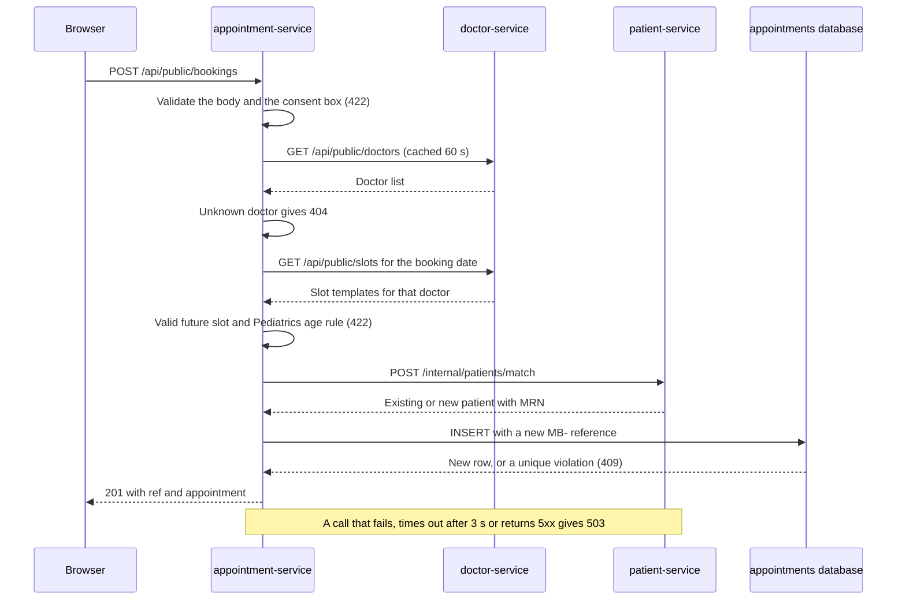

# Services

MediBook has four FastAPI services (Python 3.12) and an Nginx frontend. This page lists every endpoint, the booking flow and the settings of each service. Everything here is taken from `services/*/main.py`, `frontend/nginx.conf`, `docker-compose.yml` and `k8s/`.

| Service | Local port | Database | Calls |
|---|---|---|---|
| auth-service | 8004 | none | nothing |
| doctor-service | 8001 | `doctors` | nothing |
| patient-service | 8002 | `patients` | nothing |
| appointment-service | 8003 | `appointments` | doctor-service, patient-service |
| frontend | 8080 | none | the four APIs (locally, as a reverse proxy) |

Inside its container every API listens on port 8000. Locally, each one has interactive docs at `http://localhost:800X/docs`.

## Shared conventions

### Access levels

| Level | Path prefix | Who can call it |
|---|---|---|
| Public | `/api/public/...`, `/api/auth/login` | Anyone, through Nginx or the ALB |
| Staff | `/api/staff/...`, `/api/auth/me` | Requests with `Authorization: Bearer <token>` from auth-service |
| Internal | `/internal/...` | Other services and the seed job only. Nginx returns 404 and the ALB never routes it |
| Operations | `/health`, `/ready`, `/version`, `/metrics` | Probes, Prometheus and direct calls on the service port. Not routed by Nginx or the ALB |

Staff tokens are JWTs signed with HS256 and the issuer `medibook-auth`. patient-service and appointment-service verify them locally with the shared `JWT_SECRET`. A missing or bad token gets `401` ("Sign in required" or "Your session has ended. Please sign in again."). If `JWT_SECRET` is not set, staff endpoints return `503` "Staff sign-in is not configured".

### Operational endpoints

Every API has these four endpoints.

| Endpoint | Purpose | Behaviour |
|---|---|---|
| `GET /health` | Liveness | Always `{"status": "ok"}`. Never touches the database, so a database outage does not restart the pod |
| `GET /ready` | Readiness | `{"status": "ready"}`, or `503` until the service's database is reachable. auth-service returns `503` until `STAFF_EMAIL`, `STAFF_PASSWORD` and `JWT_SECRET` are set |
| `GET /version` | Version check | `{"service": "...", "version": "..."}` from `APP_VERSION` |
| `GET /metrics` | Prometheus | Request counts and latency from `prometheus-fastapi-instrumentator`. `/metrics`, `/health` and `/ready` are left out of the numbers |

On Kubernetes, the startup and liveness probes call `/health`, and the readiness probe and the ALB health check call `/ready`.

### Errors

| Status | Meaning |
|---|---|
| `401` | Staff endpoint without a valid token, or a wrong sign-in |
| `404` | Unknown id (doctor, patient, appointment), or `/internal/seed` while seeding is off |
| `409` | The slot already has an active booking |
| `422` | Invalid body or query, or a booking rule failed. The `detail` field has a message the web app shows as is |
| `503` | The service's database, a service it calls, or the sign-in settings are missing. The message names the cause |

## auth-service

Staff sign-in for one front-desk account set in environment variables. It has no database. The password is hashed at start (PBKDF2-HMAC-SHA256, random salt, 200,000 iterations) and compared in constant time.

| Access | Method and path | Request | Response |
|---|---|---|---|
| Public | `POST /api/auth/login` | `{"email", "password"}` | `token`, `expires_in` (seconds), `user` (`email`, `name`, `role`). `401` for a wrong email or password |
| Staff | `GET /api/auth/me` | Bearer token | `email`, `name`, `role` from the token |
| Internal | none | | |

| Variable | Default | Local source | AWS source |
|---|---|---|---|
| `JWT_SECRET` | none, required | `.env` | Secrets Manager `medibook/dev/jwt` |
| `STAFF_EMAIL` | none, required | `.env` | Secrets Manager `medibook/dev/staff-login` |
| `STAFF_PASSWORD` | none, required | `.env` | Secrets Manager `medibook/dev/staff-login` |
| `STAFF_NAME` | `Front desk` | `.env` | Secrets Manager `medibook/dev/staff-login` |
| `STAFF_ROLE` | `Receptionist` | `.env` | Secrets Manager `medibook/dev/staff-login` |
| `TOKEN_TTL_SECONDS` | `28800` (8 hours) | not set | not set |
| `APP_VERSION` | `1.0.0` | `.env` | not set |

## doctor-service

Departments, doctors and the clinic's opening rules. It creates its tables and the roster of five departments and five doctors (`d1` to `d5`) at start.

| Access | Method and path | Request | Response |
|---|---|---|---|
| Public | `GET /api/public/departments` | | The five departments: `name`, `description`, `icon` |
| Public | `GET /api/public/doctors` | | All doctors: `id`, `name`, `department`, `room`, `days` (0 = Sunday to 6 = Saturday), `languages` |
| Public | `GET /api/public/doctors/{doctor_id}` | | One doctor, or `404` "Doctor not found" |
| Public | `GET /api/public/slots` | Query: `start` (date, required), `days` (1 to 90, default 1), `doctor_id` (optional) | Per date: `closed_reason` and the slot times per doctor. Bookings are not included. `404` for an unknown doctor |
| Staff | none | | |
| Internal | none | | |

Clinic rules (in `schedule.py`): 30-minute slots, Monday to Friday 9:00 to 17:00, Saturday 9:00 to 13:00. Closed on Sundays and on New Year's Day, Family Day, Victoria Day, Canada Day, Labour Day, Thanksgiving, Christmas Day and Boxing Day. Good Friday is not handled yet.

| Variable | Default | Local source | AWS source |
|---|---|---|---|
| `DB_HOST`, `DB_PORT` | `localhost`, `5432` | Compose (`db`, `5432`) | Secrets Manager `medibook/dev/doctor-service/db` |
| `DB_NAME`, `DB_USER` | `doctors`, `doctor_service` | Compose | Secrets Manager `medibook/dev/doctor-service/db` |
| `DB_PASSWORD` | empty | `.env` (`DOCTOR_DB_PASSWORD`) | Secrets Manager `medibook/dev/doctor-service/db` |
| `DB_SSLMODE` | `prefer` | not set | `require` (Deployment) |
| `APP_VERSION` | `1.0.0` | `.env` | not set |

## patient-service

Patient records and medical record numbers. PostgreSQL generates the MRN from the id (`MRN-` followed by `10240 + id`, so the first patient is `MRN-10241`).

| Access | Method and path | Request | Response |
|---|---|---|---|
| Staff | `GET /api/staff/patients` | Query: `q` (optional) | Patients sorted by name. `q` matches name, MRN, email or phone digits |
| Staff | `GET /api/staff/patients/{patient_id}` | | One patient, or `404` "Patient not found" |
| Staff | `POST /api/staff/patients` | `full_name` (required), `dob`, `phone`, `email`, `health_card` | `201` with the new patient and its MRN |
| Internal | `GET /internal/patients/{patient_id}` | | One patient, or `404`. Used by staff bookings |
| Internal | `POST /internal/patients/match` | Patient details | The matching or new patient, plus `created` (`true` or `false`). Used by online bookings |
| Internal | `POST /internal/seed` | List of demo patients | Loads them only into an empty table and returns all patients. `404` unless `SEED_ENABLED=true` |
| Public | none | | |

A patient has `id`, `mrn`, `full_name`, `dob`, `phone`, `email`, `health_card` and `created_at`. The match uses the same name (any case) and the same phone digits, then the same name and email. A date of birth in the future returns `422`.

| Variable | Default | Local source | AWS source |
|---|---|---|---|
| `DB_HOST`, `DB_PORT` | `localhost`, `5432` | Compose (`db`, `5432`) | Secrets Manager `medibook/dev/patient-service/db` |
| `DB_NAME`, `DB_USER` | `patients`, `patient_service` | Compose | Secrets Manager `medibook/dev/patient-service/db` |
| `DB_PASSWORD` | empty | `.env` (`PATIENT_DB_PASSWORD`) | Secrets Manager `medibook/dev/patient-service/db` |
| `DB_SSLMODE` | `prefer` | not set | `require` (Deployment) |
| `JWT_SECRET` | none | `.env` | Secrets Manager `medibook/dev/jwt` |
| `SEED_ENABLED` | `false` | `true` (Compose) | `false` (Deployment) |
| `APP_VERSION` | `1.0.0` | `.env` | not set |

## appointment-service

Availability, online and staff bookings, and appointment status. It is the only service that calls other services. A partial unique index on `(doctor_id, start_at)` for rows that are not cancelled makes sure a doctor never has two active bookings at the same time.

| Access | Method and path | Request | Response |
|---|---|---|---|
| Public | `GET /api/public/availability` | Query: `doctor_id` (required), `limit` (1 to 30, default 12) | The next days, within 42 days, that have a free slot: `date`, `open`, `slots` (`time`, `free`). `404` for an unknown doctor |
| Public | `GET /api/public/next-available` | | The first free slot per doctor within 42 days: `doctor_id`, `date`, `time` |
| Public | `GET /api/public/summary` | | `open_slots_7d`: free slots across all doctors in the next 7 days |
| Public | `POST /api/public/bookings` | See the example below | `201` with `ref` (`MB-` plus 4 characters) and `appointment` |
| Staff | `GET /api/staff/appointments` | Query: `start`, `end` (dates, inclusive), `doctor_id`, `patient_id`, `status`, `limit` (1 to 5000, default 2000) | Appointments sorted by start time |
| Staff | `POST /api/staff/appointments` | `patient_id`, `doctor_id`, `date`, `time`, `type`, `reason` | `201` with the appointment. Source `staff`, no booking reference |
| Staff | `PATCH /api/staff/appointments/{appointment_id}` | `status`: `scheduled`, `completed` or `cancelled` | The updated appointment |
| Internal | `POST /internal/seed` | List of demo appointments | `inserted` and `skipped`. Fills only an empty table. `404` unless `SEED_ENABLED=true` |

An appointment has `id`, `ref`, `patient_id`, `patient_name`, `patient_mrn`, `doctor_id`, `start` (`YYYY-MM-DDTHH:MM`, clinic time), `type`, `reason`, `status`, `source` (`online` or `staff`) and `created_at`.

### Booking flow



All rule checks run before patient-service is called, so a rejected booking never creates a patient record. The appointment keeps a copy of the patient's name and MRN, so staff lists need no call to patient-service.

Example request (use a future clinic day and a free time):

```bash
curl -X POST http://localhost:8080/api/public/bookings \
  -H "Content-Type: application/json" \
  -d '{
    "doctor_id": "d1",
    "date": "2026-11-03",
    "time": "09:00",
    "type": "New patient",
    "reason": "Check-up",
    "consent": true,
    "patient": {"full_name": "Asha Rao", "dob": "1990-04-12", "phone": "416-555-0101"}
  }'
```

### Booking rules

| Rule | Detail |
|---|---|
| Valid slot | The time must be one of the doctor's slot templates on that day, and later than the current clinic time |
| Consent | Online bookings need `"consent": true` |
| Patient details | Online bookings need `full_name`, `dob` and `phone`. `email` and `health_card` are optional |
| Pediatrics | Patients must be under 18 on the day of the visit. A staff booking for a patient with no date of birth is allowed |
| Visit types | `New patient` (default), `Follow-up`, `Consultation`, `Annual physical`, `Vaccination`. `reason` is up to 300 characters |
| Completing | Only appointments that start today or earlier can be marked `completed` |
| Restoring | A cancelled appointment can go back to `scheduled` only if its slot is still free (`409` otherwise) |

| Variable | Default | Local source | AWS source |
|---|---|---|---|
| `DB_HOST`, `DB_PORT` | `localhost`, `5432` | Compose (`db`, `5432`) | Secrets Manager `medibook/dev/appointment-service/db` |
| `DB_NAME`, `DB_USER` | `appointments`, `appointment_service` | Compose | Secrets Manager `medibook/dev/appointment-service/db` |
| `DB_PASSWORD` | empty | `.env` (`APPOINTMENT_DB_PASSWORD`) | Secrets Manager `medibook/dev/appointment-service/db` |
| `DB_SSLMODE` | `prefer` | not set | `require` (Deployment) |
| `DOCTOR_SERVICE_URL` | `http://doctor-service:8000` | Compose | Deployment, same value |
| `PATIENT_SERVICE_URL` | `http://patient-service:8000` | Compose | Deployment, same value |
| `CLINIC_TZ` | `America/Toronto` | Compose | Deployment, same value |
| `JWT_SECRET` | none | `.env` | Secrets Manager `medibook/dev/jwt` |
| `SEED_ENABLED` | `false` | `true` (Compose) | `false` (Deployment) |
| `APP_VERSION` | `1.1.0` | `.env` (`1.0.0`) | not set, so `/version` reports `1.1.0` |

## frontend

A static web app (`index.html`, `styles.css`, `app.js`) served by `nginxinc/nginx-unprivileged` on port 8080. It has no environment variables; its behaviour is set by `frontend/nginx.conf`.

| Path | Behaviour |
|---|---|
| `/` | Serves the app. Screens use hash routes such as `#book` and `#login`, so the server always returns `index.html` |
| `/api/...` | Locally, forwarded to the service from the [routing table](architecture.md#request-routing). On AWS, the ALB sends `/api/...` to the services directly |
| `/internal/...` | `404` |

Nginx adds `X-Content-Type-Options: nosniff`, `X-Frame-Options: DENY` and `Referrer-Policy: no-referrer`, hides its version, and gives up connecting to a service after 5 seconds. The browser keeps the staff token in `sessionStorage` and sends it only on staff calls.
