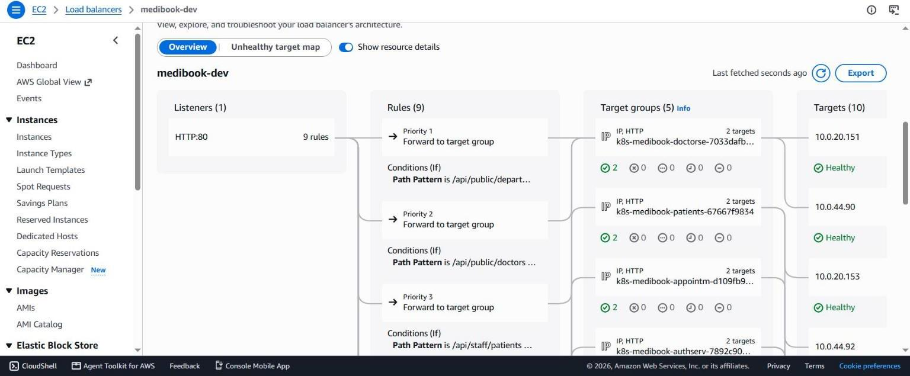

# Setup

This guide builds the whole MediBook environment, starting from an empty AWS account. The design is explained in [architecture.md](architecture.md) and the infrastructure code in [terraform.md](terraform.md). To remove everything again, see [cleanup.md](cleanup.md).

Commands use bash syntax (Git Bash on Windows) and run from the repository root unless a step says otherwise.

## Prerequisites

**AWS account**

- An IAM admin user (AWS managed policy `AdministratorAccess`) with console access and MFA. Do not use the root user for daily work, and do not create access keys.
- The CLI signed in with `aws login`. It gets short-lived credentials from the console sign-in, so no key is stored on the laptop. Terraform uses the same login.

```bash
aws login --region ca-central-1
aws sts get-caller-identity           # must show the IAM admin user
aws configure set region ca-central-1
```

When the session expires, run `aws login` again.

**Tools**

| Tool | Version | Used for |
|---|---|---|
| AWS CLI | v2 (tested 2.37.12) | `aws login` and checks |
| Terraform | 1.11 or newer (tested 1.16.5, the version CI uses) | The infrastructure |
| kubectl | Within one minor version of the cluster's 1.35 (tested 1.34.1) | Cluster access |
| Helm | Tested 4.3.0 | Installs Argo CD |
| bash, openssl | Any | `scripts/bootstrap.sh` (Git Bash includes both) |

You also need a GitHub repository with this code and GitHub Actions enabled. The GitHub CLI (`gh`) is optional; it is used once below to read the repository IDs.

## Account notes

- **Region:** everything runs in `ca-central-1`. Terraform picks the availability zones where the node instance type is offered (this account has no `ca-central-1c`), so no zone names are hard-coded.
- **AWS Free plan:** only Free Tier eligible instance types launch. Eligible means allowed, not free: usage is paid from the account's credits. This is why the nodes are `m7i-flex.large`. `t3.medium` was refused (`not eligible for Free Tier`), and the node group failed after 33 minutes. An EC2 `--dry-run` does not check eligibility. This command does:

  ```bash
  aws ec2 describe-instance-types --filters Name=free-tier-eligible,Values=true \
    --query "InstanceTypes[].InstanceType" --output text
  ```

- The database follows the RDS Free tier template: `db.t4g.micro`, Single-AZ, 20 GiB gp2 storage and 1-day backups.
- Route 53 domain registration is not available on the Free plan, so the site is served over HTTP only.
- An AWS account can have only one GitHub OIDC provider (`token.actions.githubusercontent.com`). If the account already has one, import it into the state (`module.github_oidc.aws_iam_openid_connect_provider.github`) or delete it before step 2.

## GitHub settings

| Setting | What to do |
|---|---|
| Environment `dev` | **Settings → Environments → New environment** `dev`. Add a required reviewer and limit deployment branches to `main`. Create it before the first run of the Terraform apply workflow, because on that run GitHub would otherwise create the environment without protection. The `tf-apply` role trusts only jobs that run in this environment. |
| Repository secrets | None are needed. The workflows get AWS access through OIDC, and the tag commit uses the built-in `GITHUB_TOKEN`. |
| Pushes to `main` | The last job of Service CI pushes the image tag commit straight to `main` as `github-actions[bot]`. A branch rule that blocks direct pushes would stop it. |

## Steps

### 1. Create the state bucket

```bash
cd terraform/bootstrap
terraform init
terraform plan -out=bootstrap.tfplan
terraform apply bootstrap.tfplan
terraform output -raw state_bucket    # medibook-tfstate-<account-id>
```

Expected: `Apply complete! Resources: 7 added`. This stack keeps its state in a local file, `terraform/bootstrap/terraform.tfstate`. The file is git-ignored and is the only record of the bucket, so keep it safe and back it up.

In PowerShell, quote the flag: `terraform plan "-out=bootstrap.tfplan"`.

In another account, first update the values marked **Before step 2** in [the table below](#values-tied-to-this-account-or-this-build).

### 2. Build the infrastructure

```bash
cd ../envs/dev
terraform init
terraform plan -out=dev.tfplan
terraform apply dev.tfplan
```

The plan creates about 95 resources: the VPC, the EKS cluster and nodes, five ECR repositories, RDS PostgreSQL, the Secrets Manager secrets, IAM roles for CI and pods, the services log group and the CloudWatch alarms. On an empty account, the last line of the plan should read `Plan: 95 to add, 0 to change, 0 to destroy` (96 with `alarm_email`). The EKS cluster takes about 10 minutes and the RDS instance about 6 minutes. Everything else is faster.

Run this step from the laptop. The GitHub Actions roles are created by this apply, so the Terraform apply workflow can only be used after it.

Optional: to receive alarm emails, add `-var alarm_email=<address>` to the plan, then click the confirmation link that AWS sends.

Next, update the values marked **After step 2** in [the table below](#values-tied-to-this-account-or-this-build), then commit and push them to `main`. In this account, a rebuild changes only the RDS admin secret name.

### 3. Connect kubectl

```bash
aws eks update-kubeconfig --region ca-central-1 --name medibook-dev
kubectl get nodes                     # 2 nodes, Ready
```

Only the IAM principals listed in `cluster_admin_arns` can use the cluster. Access is controlled by EKS access entries, and the creator gets no automatic access. Every other caller gets HTTP 401.

### 4. Build and push the images

ECR starts empty. On `main`, Service CI pushes an image whenever that service's code changes. For a fresh build, run it by hand: **Actions → Service CI → Run workflow** on `main`. A manual run tests, builds, scans and pushes all five images as `medibook-<service>:<short commit SHA>`. It then commits the new tags to `k8s/<service>/kustomization.yaml` with the message `Deploy ... [skip ci]`.

If your push in step 2 changed `.github/workflows/service-ci.yml`, that push has already started a full run.

When the run is green, pull the bot commit and check one repository:

```bash
git pull
aws ecr describe-images --repository-name medibook-frontend --query "imageDetails[].imageTags"
```

### 5. Install Argo CD

From the repository root:

```bash
bash scripts/bootstrap.sh
```

The script first checks that kubectl, helm and openssl are installed and prints the current kubectl context. Make sure the context is the new cluster. Then the script:

1. installs Argo CD (chart `argo-cd` 10.9.2, Argo CD v3.5.3) into the `argocd` namespace with `k8s/argocd/values.yaml`
2. creates the Grafana admin Secret `monitoring/grafana-admin` with a random password, or keeps the existing one
3. applies the root application `k8s/argocd/root.yaml`

The script is safe to run again. Argo CD reads the Git repository anonymously, so the repository must be public.

### 6. Wait for the applications

```bash
kubectl get applications -n argocd --watch
```

Argo CD creates 14 applications and syncs them in waves (see [cicd-gitops.md](cicd-gitops.md#argo-cd)). It waits for each wave to be healthy before it starts the next one. Continue when every application shows `Synced` and `Healthy`.

To open the Argo CD UI, run `kubectl port-forward service/argocd-server -n argocd 8080:80` and browse to `http://localhost:8080`. Sign in as `admin`; the bootstrap script prints the command that reads the initial password.

### 7. Get the URL

```bash
kubectl get ingress medibook -n medibook
ALB=$(kubectl get ingress medibook -n medibook -o jsonpath='{.status.loadBalancer.ingress[0].hostname}')
echo "http://$ALB"
```

The `ADDRESS` column shows the ALB DNS name, `medibook-dev-<id>.ca-central-1.elb.amazonaws.com`. The ALB becomes active about 2 minutes after the `ingress` application syncs. The site uses HTTP only.



### 8. Sign in as staff

Open **Secrets Manager → `medibook/dev/staff-login` → Retrieve secret value**. Enter `STAFF_EMAIL` and `STAFF_PASSWORD` under **Staff sign in** on the site. The CLI command below prints the password in the terminal:

```bash
aws secretsmanager get-secret-value --secret-id medibook/dev/staff-login --query SecretString --output text
```

### 9. Verify

Run from the repository root, with `ALB` set as in step 7.

| Check | Command or action | Expected |
|---|---|---|
| Nodes | `kubectl get nodes` | 2 nodes, `Ready` |
| Applications | `kubectl get applications -n argocd` | 14 applications, all `Synced` and `Healthy` |
| App pods | `kubectl get pods,hpa -n medibook` | 10 pods `Running` (2 per service); each HPA 2 to 4 replicas |
| Secrets | `kubectl get clustersecretstore,externalsecrets -A` | Store `Valid`; every ExternalSecret `SecretSynced` |
| Site | `curl -s -o /dev/null -w "%{http_code}\n" "http://$ALB/"` | `200` |
| Public API | Same, with `/api/public/doctors` | `200` |
| Internal routes | Same, with `/internal/seed` | `404` |
| Staff API without a token | Same, with `/api/staff/patients` | `401` |
| Booking | Book an appointment in the browser | Confirmation with a reference `MB-...` |
| Staff sign-in | Step 8 | Staff dashboard |
| Logs | CloudWatch log group `/medibook/dev/services` | One log stream per pod |
| Alarms | `aws cloudwatch describe-alarms --alarm-name-prefix medibook-dev --query "MetricAlarms[].[AlarmName,StateValue]"` | 6 alarms, `OK` (a new alarm can show `INSUFFICIENT_DATA` for its first minutes) |
| Drift | `terraform -chdir=terraform/envs/dev plan -detailed-exitcode` | `No changes`, exit code 0 |
| CI | **Actions → Terraform CI → Run workflow** | Both jobs green; the plan summary says there are no changes |

## Values tied to this account or this build

These values are hard-coded in the repository. In another account, update all of them. A rebuild in this account changes only the RDS admin secret name and the ALB DNS name.

| Value | Current value | Hard-coded in | Update |
|---|---|---|---|
| State bucket name | `medibook-tfstate-710590320983` | `terraform/envs/dev/backend.tf` (`bucket`), `terraform/envs/dev/iam.tf` (`locals.state_bucket`) | Before step 2 |
| Cluster admin | `arn:aws:iam::710590320983:user/medibook-admin` | `terraform/envs/dev/variables.tf` (`cluster_admin_arns`) | Before step 2 |
| GitHub repository, in OIDC subject form | `<owner>@<owner-id>/<repo>@<repo-id>` | `terraform/envs/dev/variables.tf` (`github_repository`) | Before step 2 |
| CI role ARNs (`role-to-assume`) | `arn:aws:iam::710590320983:role/medibook-dev-github-*` | `.github/workflows/terraform-ci.yml` (`tf-plan`), `.github/workflows/terraform-apply.yml` (`tf-apply`), `.github/workflows/service-ci.yml` (`ecr-push`) | After step 2 |
| ECR registry (`newName`) | `710590320983.dkr.ecr.ca-central-1.amazonaws.com/medibook-*` | `k8s/auth-service/kustomization.yaml`, `k8s/doctor-service/kustomization.yaml`, `k8s/patient-service/kustomization.yaml`, `k8s/appointment-service/kustomization.yaml`, `k8s/frontend/kustomization.yaml` | After step 2 |
| IRSA role ARNs (`eks.amazonaws.com/role-arn`) | `arn:aws:iam::710590320983:role/medibook-dev-*` | `k8s/argocd/apps/aws-load-balancer-controller.yaml`, `k8s/argocd/apps/external-secrets.yaml`, `k8s/logging/fluent-bit-values.yaml` | After step 2 |
| VPC | found by the tag `Name=medibook-dev` | `k8s/argocd/apps/aws-load-balancer-controller.yaml` (`vpcTags`) | Never in this account; only if the project or environment name changes |
| RDS admin secret name | `rds!db-ad565031-5a6a-4e7c-85c1-f42a1b8f89a0` | `k8s/platform/db-init-external-secret.yaml` (the `key` of `PGUSER` and `PGPASSWORD`) | After step 2, on every rebuild or whenever the instance is replaced |
| Git repository URL (`repoURL`) | The repository's HTTPS clone URL | `k8s/argocd/root.yaml` and `k8s/argocd/apps/{auth-service,doctor-service,patient-service,appointment-service,frontend,platform,ingress,network-policies,monitoring,monitoring-config,logging}.yaml` | Before step 5, if the repository changes |
| ALB DNS name | `medibook-dev-<id>.ca-central-1.elb.amazonaws.com` | Not in code (only the ALB name `medibook-dev` is fixed, in `k8s/ingress/ingress.yaml`) | After step 7, in any page or bookmark that quotes the live URL |

Where to get each new value:

```bash
# Before step 2
terraform -chdir=terraform/bootstrap output -raw state_bucket
aws sts get-caller-identity --query Arn --output text
gh api repos/<owner>/<repo> --jq '"\(.owner.login)@\(.owner.id)/\(.name)@\(.id)"'

# After step 2 (inside terraform/envs/dev)
terraform output github_role_arns
terraform output ecr_repository_urls
terraform output irsa_role_arns
terraform output -raw vpc_id
aws secretsmanager describe-secret --secret-id "$(terraform output -raw db_master_secret_arn)" \
  --query Name --output text

# After step 7
kubectl get ingress medibook -n medibook
```

The `github_repository` value contains the immutable owner and repository IDs, so it also changes when the repository is forked, or deleted and created again. Changing the region, project or environment name affects more files: workflow `AWS_REGION`, `clusterName` and `region` of the load balancer controller, `k8s/platform/cluster-secret-store.yaml`, the Fluent Bit region and log group, and the `medibook/dev/...` secret names in the ExternalSecrets.

The three ALB alarms query every ALB in the region. In an account with other load balancers in `ca-central-1`, they would include those too.

## Next

- Day-to-day work: [operations.md](operations.md)
- When something fails: [troubleshooting.md](troubleshooting.md)
- Running cost: [costs.md](costs.md)
- Teardown: [cleanup.md](cleanup.md)
